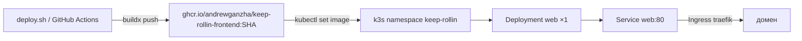

# Деплой frontend в k3s

Nuxt SSR-приложение живёт в namespace `keep-rollin` на вашей ВМ с k3s.
Образ собирается локально/в CI (на ВМ ничего не собирается: `nuxt build` валит
небольшую машину), пушится в GHCR, деплой — `kubectl` + встроенный Traefik.



Файлы:

| Файл | Назначение |
| ---- | ---------- |
| `frontend/Dockerfile` | multi-stage: pnpm build → `.output` в `node:22-slim`, non-root |
| `deploy/k8s/namespace.yaml` | namespace `keep-rollin` |
| `deploy/k8s/app.yaml` | ConfigMap, Deployment (probes, limits, read-only rootfs), Service |
| `deploy/k8s/ingress.yaml` | Ingress с плейсхолдером `__INGRESS_HOST__` |
| `deploy/deploy.sh` | сборка → push → apply → rollout → smoke → откат |
| `.github/workflows/deploy-frontend.yml` | CI: push в `master` собирает и деплоит |

## 1. Один раз: доступ к кластеру

С машины разработчика:

```sh
scp <user>@<vm>:/etc/rancher/k3s/k3s.yaml ~/.kube/keep-rollin.yaml
chmod 600 ~/.kube/keep-rollin.yaml
sed -i '' 's|https://127.0.0.1:6443|https://<vm-ip>:6443|' ~/.kube/keep-rollin.yaml
export KUBECONFIG=~/.kube/keep-rollin.yaml   # или KUBE_CONTEXT в deploy.env
kubectl get nodes
```

Если 6443 закрыт файрволом, пробросьте его через SSH и оставьте в kubeconfig
`https://127.0.0.1:6443`:

```sh
ssh -N -L 6443:127.0.0.1:6443 <user>@<vm>
```

`KUBE_CONTEXT` в `deploy/deploy.env` нужен, только если в конфиге несколько
контекстов.

## 2. Один раз: образ в GHCR

Первый `push` создаёт пакет. Дальше один из вариантов:

- сделать пакет публичным: GitHub → Packages → `keep-rollin-frontend` → Settings →
  Change visibility → Public;
- или оставить приватным и дать кластеру pull-secret:

```sh
kubectl -n keep-rollin create secret docker-registry ghcr-pull \
  --docker-server=ghcr.io \
  --docker-username=<github-login> \
  --docker-password=<PAT с read:packages>
kubectl -n keep-rollin patch deployment web --patch \
  '{"spec":{"template":{"spec":{"imagePullSecrets":[{"name":"ghcr-pull"}]}}}}'
```

`deploy.sh` не пересоздаёт Deployment, поэтому патч с pull-secret сохраняется
между релизами.

## 3. Конфигурация деплоя

```sh
cp deploy/deploy.env.example deploy/deploy.env
```

`deploy/deploy.env` в `.gitignore`. Переменные:

| Переменная | По умолчанию | Смысл |
| ---------- | ------------ | ----- |
| `IMAGE_REPO` | `ghcr.io/andrewganzha/keep-rollin-frontend` | репозиторий образа |
| `IMAGE_TRANSPORT` | `registry` | `registry` — push и pull кластером; `ssh-import` — импорт в containerd по SSH |
| `K3S_SSH_TARGET` | — | `user@host` для `ssh-import` |
| `K3S_SSH_KEY` | `~/.ssh/id_rsa` | ключ для `ssh-import` |
| `K3S_SSH_KNOWN_HOSTS` | `~/.ssh/known_hosts` | known_hosts для `ssh-import` |
| `IMAGE_TAG` | git commit | тег релиза |
| `PLATFORM` | `linux/amd64` | архитектура узла k3s (`uname -m` на ВМ) |
| `KUBE_CONTEXT` | текущий | контекст kubectl |
| `INGRESS_HOST` | пусто | домен; без него Ingress не применяется |
| `SMOKE_PORT` | `18080` | локальный порт port-forward для проверки |

Docker должен быть залогинен в GHCR: `docker login ghcr.io`.

Без реестра — импорт образа прямо в containerd (нужен passwordless sudo на
`k3s ctr`):

```sh
IMAGE_TRANSPORT=ssh-import K3S_SSH_TARGET=user@host ./deploy/deploy.sh
```

Скрипт собирает образ с `--load` и выполняет
`docker save | gzip | ssh 'gunzip | sudo -n k3s ctr images import -'`.
Deployment уже использует `imagePullPolicy: IfNotPresent`, поэтому кластер
не пойдёт в реестр.

## 4. Релиз

```sh
./deploy/deploy.sh
```

Скрипт отказывается деплоить грязное дерево (`DEPLOY_ALLOW_DIRTY=1` — обойти;
тогда тег получает `-dirty-<UTC timestamp>`, чтобы rollout не остался на старом
образе), после `rollout status` проверяет `/health` **и рендер `/`** через
port-forward (висящий SSR ловится по таймауту), при провале делает
`kubectl rollout undo`.

Если задан `K3S_SSH_TARGET` и `127.0.0.1:6443` недоступен, скрипт сам поднимает
`ssh -N -L 6443:127.0.0.1:6443` и закрывает туннель в конце. Отключить:
`K3S_TUNNEL=0`. `KUBECONFIG` из `deploy/deploy.env` экспортируется автоматически.

Проверить вручную:

```sh
kubectl -n keep-rollin get pods,deploy,svc,ingress
kubectl -n keep-rollin rollout status deployment/web
kubectl -n keep-rollin port-forward svc/web 8080:80   # затем http://127.0.0.1:8080
```

Откат вручную: `kubectl -n keep-rollin rollout undo deployment/web`.

## 5. Домен и HTTPS

DNS: A-запись домена на IP ВМ. Затем `INGRESS_HOST=<domain> ./deploy/deploy.sh` —
Ingress применится на Traefik, который k3s ставит по умолчанию, и сайт откроется
по HTTP.

HTTPS пока не включён: cert-manager в k3s нет, а self-signed сертификат ломает
установку PWA. Когда понадобится:

```sh
kubectl apply -f https://github.com/cert-manager/cert-manager/releases/latest/download/cert-manager.yaml
```

создать `ClusterIssuer` Let's Encrypt и добавить в `deploy/k8s/ingress.yaml` блок
`tls` (закомментированный шаблон уже есть).

## 6. Backend API

Сейчас `/api/**` никто не обслуживает: страницы показывают состояние ошибки.
Когда появится backend (в том же кластере или на ВМ), укажите адрес и
перезапустите:

```sh
kubectl -n keep-rollin patch configmap web-config --patch \
  '{"data":{"NUXT_API_PROXY_TARGET":"http://backend.keep-rollin.svc:8000"}}'
kubectl -n keep-rollin rollout restart deployment/web
```

`server/middleware/api-proxy.ts` проксирует запросы в рантайме; в dev за `/api`
отвечает mock-server через `nitro.devProxy`.

## 7. CI

Workflow `.github/workflows/deploy-frontend.yml` на push в `master` собирает
`linux/amd64` образ и деплоит. API кластера слушает только `127.0.0.1:6443`,
поэтому CI поднимает тот же SSH-туннель, что и локальный `deploy.sh`.

Секреты репозитория:

| Секрет | Обязателен | Содержимое |
| ------ | ---------- | ---------- |
| `KUBE_CONFIG` | для деплоя | `base64 < ~/.kube/keep-rollin.yaml` |
| `K3S_SSH_TARGET` | для туннеля | `user1@192.144.14.13` |
| `K3S_SSH_KEY` | для туннеля | приватный ключ из `~/.ssh/keep-rollin` |
| `K3S_SSH_KNOWN_HOSTS` | для туннеля | `ssh-keyscan -t ed25519 192.144.14.13` |

Variable `INGRESS_HOST` — домен, если нужен Ingress.

Режимы:

1. `KUBE_CONFIG` + `K3S_SSH_TARGET` → сборка, импорт образа в containerd по SSH,
   rollout через туннель (реестр для доставки не нужен).
2. Только `KUBE_CONFIG` → предполагается, что API и GHCR доступны кластеру
   (публичный пакет или pull-secret); образ пушится в GHCR.
3. Нет `KUBE_CONFIG` → workflow зелёный, только публикует образ в GHCR.

`K3S_SSH_KEY` должен соответствовать ключу в `authorized_keys` на ВМ; на сервере
нужен passwordless sudo на `k3s ctr` (см. §4).
