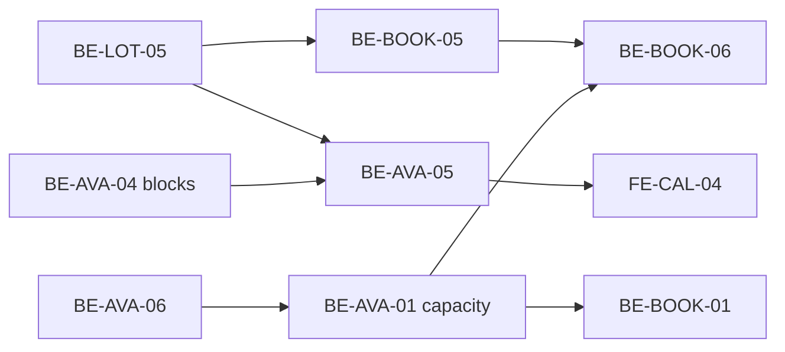

# CR-01 · Backend (BE-*)

> Навигация: [CR-01](README.md) · [Решения](decisions.md) · [Контракт](contract.md) · [Мок](mock.md) · [Фронтенд](frontend.md) · [Приёмка](qa.md)

Выполняется после переезда контракта в Pydantic (CT-03) или параллельно с ним — контракт уже описан в
[contract.md](contract.md). Новые задачи идут с новыми ID; расширения существующих помечены явно.

## Новые задачи

### BE-LOT-05 · Варианты, тарифы, сроки лота

**Зависит:** BE-LOT-01.
**Объём:** таблицы `lot_variant` и `lot_price_tier`, CRUD в `PATCH /admin/lots/{id}` (`version`), валидация инвариантов
D-19/D-20/D-25, `price_from` в выдаче каталога и админки, миграция `price → variants` (§10.5 контракта).
**AC:**

- [ ] Старые лоты мигрируют в один вариант `battery_count: 1` с тиром `min_units: 1`, суммы не меняются.
- [x] Некорректная сетка (растущая цена, дубли `min_units`, тир ниже минимума сроков) → `422` с путём поля. POST/PATCH сохраняют варианты и сроки, PATCH сохраняет UUID оставшихся вариантов.
- [ ] Правка тарифов не меняет `rental.price_minor` существующих аренд.

### BE-BOOK-06 · Quote

**Зависит:** BE-BOOK-05, BE-LOT-05, BE-AVA-01.
**Объём:** `GET /public/lots/{slug}/quote`: расчёт цены по каждому активному варианту, проверка слота и ёмкости,
`unavailable_reason`, `no-store`.
**AC:**

- [x] Ничего не пишет в БД (проверяется тестом на отсутствие изменений).
- [ ] p95 ≤ 150 мс при 20 вариантах и 200 интервалах занятости.
- [x] Цена quote совпадает с ценой созданной аренды на том же интервале и варианте (тест).

### BE-AVA-05 · Расписание для ганта

**Зависит:** BE-AVA-01, BE-AVA-04, BE-LOT-05.
**Объём:** `GET /admin/schedule?from&to&category_id`: лоты (включая свободные), интервалы аренд и блоков, `battery_stock`
с `peak_committed`; окно ≤ 90 дней.
**AC:**

- [ ] Один запрос на экран, ≤ 200 мс на 30 днях × 50 лотах.
- [ ] Лоты без событий присутствуют.
- [ ] Аренда на границе окна отдаётся обрезанной по границе, а не выпадает.

### BE-AVA-06 · Остатки аккумуляторов

**Зависит:** BE-TEN-01.
**Объём:** таблица `battery_stock` + CRUD, `peak_committed` по активным и будущим арендам, `stock_below_committed`.
**AC:**

- [x] Уменьшение количества ниже пика → `409 stock_below_committed` с числами в проблеме.
- [x] Удаление типа стока при существующих арендах → `409`.
- [x] Изменения пишутся в audit.

## Расширения существующих задач

| Задача | Что добавляется | AC (ядро) |
| ------ | --------------- | --------- |
| `BE-BOOK-05` | цена по тирам и round-up D-20, `contract/pricing.md` | 20+ голден-векторов зелёные; совпадение с моком 1:1 |
| `BE-BOOK-01` | `variant_id` вместо свободной цены; проверка ёмкости АКБ в той же транзакции | две параллельные брони на последний АКБ → ровно один `201`; `battery_unavailable` внятен |
| `BE-AVA-01` | occupancy + capacity: `EXCLUDE` по лоту и агрегатная проверка по `battery_stock` под блокировкой строки стока | гонка покрыта тестом; порядок проверок: слот лота → ёмкость АКБ |
| `BE-AVA-04` | блоки выравниваются по суткам TZ тенанта, `reason` обязателен, `slot_taken` при пересечении с арендой | блок поверх аренды → `409`; удаление сразу освобождает |
| `BE-AVA-03` | остаётся для часового таймлайна; гант обслуживает `BE-AVA-05` | оба источника используют одну модель занятости |
| `BE-AN-02` | выручка не меняется, но проверить, что round-up цена попадает в `rental.price_minor` | ручной расчёт на seed совпадает |

## Порядок внутри backend

Миграции: `lot_variant`, `lot_price_tier`, `lot_block`, `battery_stock`; `lot.price` и `lot.rental_model` остаются в
таблице на время перехода, удаляются отдельной миграцией после подтверждения, что каталог и бронь работают на вариантах.
