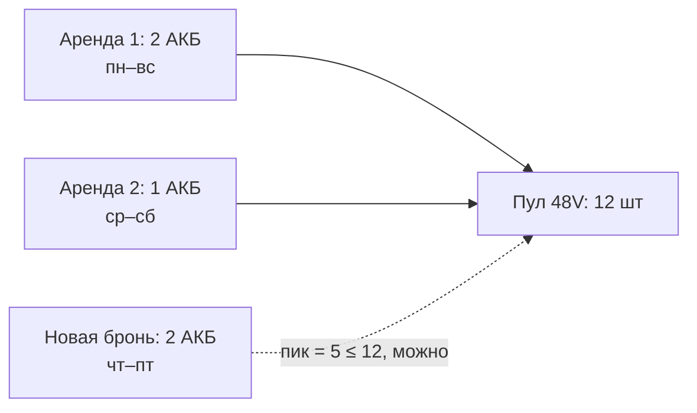

# CR-01 · Решения D-19…D-26

> Навигация: [CR-01](README.md) · [Контракт](contract.md) · [Мок](mock.md) · [Фронтенд](frontend.md) · [Backend](backend.md) · [Приёмка](qa.md)

Решения ниже дополняют D-01…D-18 из `contract/decisions.md`. Каждое решение имеет источник: номер сообщения
заказчика (§2 в [README](README.md#2-трассировка-сообщение-заказчика--задачи)).

| ID | Решение | Источник |
| -- | ------- | -------- |
| D-19 | Тариф живёт на **варианте лота**: `lot.variants[{battery_count, price_tiers}]`. Тир — `{min_units, price_per_unit_minor}`. Единица срока — `lot.rental_unit` (`day` либо `hour`) | 1, 2 |
| D-20 | Цена периода: выбирается тир с наибольшим `min_units ≤ units`; итог — `units × price_per_unit`. Если более длинный пакет дешевле, цена ограничивается его стоимостью (round-up) | 1 |
| D-21 | Неделя = 7 единиц, месяц = 30 единиц. Календарная арифметика (28/31 день) не используется | 1 |
| D-22 | Витрина показывает `price_from` = минимум `price_per_unit` по всем активным вариантам и тирам, с указанием `at_units` и `battery_count`. Подпись обязательна, если `at_units > 1` | 1 |
| D-23 | Ёмкость АКБ: в любой момент интервала сумма `battery_count` пересекающихся аренд одного `battery_type` ≤ `battery_stock.quantity`. Проверка — в одной транзакции с созданием аренды | 3 |
| D-24 | Блок ставится на целые сутки в TZ тенанта, интервал `[start, end)`. Блок не расходует АКБ и не влияет на другие лоты | 4 |
| D-25 | Разрешённые сроки — на лот: `allowed_durations: number[]` (в единицах `rental_unit`). Разрешён любой срок ≥ минимума списка; «пресеты» — элементы списка. Валидация серверная | 4 |
| D-26 | Часовой режим — только `rental_unit: hour`; отдельного UI-сценария для часов CR не добавляет | 5, 6 |

## D-20: алгоритм расчёта цены

```
input: variant, start, end, rental_unit
1. units = ceil((end - start) / unit_length)          # как в MVP, округление вверх
2. if units < min(allowed_durations) -> 422 rental_period_not_allowed
3. tier = последний тир, у которого min_units <= units
4. price = units * tier.price_per_unit_minor
5. for t in tiers, где t.min_units > units:
       price = min(price, t.min_units * t.price_per_unit_minor)   # round-up
6. return price, tier.min_units
```

Смысл шага 5: 29 суток не могут стоить дороже 30-суточного пакета. Длительность аренды при этом не меняется —
пользователь платит как за пакет, срок остаётся выбранным. В UI это подписывается: «выгоднее взять на 30 суток».

Инварианты, которые проверяет админ-форма и контракт:

- `price_tiers` отсортированы по `min_units` и не содержат дублей;
- `price_tiers[0].min_units === min(allowed_durations)`;
- `price_per_unit` не возрастает при росте `min_units` (иначе длинная аренда дороже короткой);
- `allowed_durations` отсортирован, без дублей, все значения ≥ 1;
- `battery_count` уникален в пределах лота; при `battery_count > 0` обязателен `lot.battery_type`.

## Голден-векторы (пример, числа условные)

Лот: `rental_unit = day`, `allowed_durations = [1, 3, 7, 30]`.

| Вариант | Тиры (min_units → цена за единицу) |
| ------- | ---------------------------------- |
| 1 АКБ | 1 → 1 300 ₽, 7 → 400 ₽, 30 → 400 ₽ |
| 2 АКБ | 1 → 1 500 ₽, 7 → 500 ₽, 30 → 400 ₽ |

| Суток | 1 АКБ | 2 АКБ | Что сработало |
| ----: | ----: | ----: | ------------- |
| 1 | 1 300 | 1 500 | тир 1 |
| 2 | 2 600 | 3 000 | тир 1 |
| 3 | 2 800 | 3 500 | round-up до недели (3×1 300 и 3×1 500 дороже) |
| 4 | 2 800 | 3 500 | round-up до недели |
| 6 | 2 800 | 3 500 | round-up до недели |
| 7 | 2 800 | 3 500 | тир 7 |
| 8 | 3 200 | 4 000 | тир 7 |
| 10 | 4 000 | 5 000 | тир 7 |
| 29 | 11 600 | 12 000 | 1 АКБ: тир 7 дешевле месяца; 2 АКБ: round-up до месяца |
| 30 | 12 000 | 12 000 | тир 30 |
| 31 | 12 400 | 12 400 | тир 30 |
| 60 | 24 000 | 24 000 | тир 30 |

`price_from` в этом примере: 400 ₽/сут, `at_units = 7`, `battery_count = 1` (у 2 АКБ те же 400 ₽/сут только
с 30 суток — при равенстве побеждает меньший `at_units`). Полный набор из 45 векторов и правила tie-break —
[`contract/pricing.md`](../../contract/pricing.md); таблица здесь синхронизирована с ним.

> Числа из голоса заказчика (2 800/нед с одной АКБ, 3 500/нед и 12 000/мес с двумя) в таблицу не переносятся:
> это иллюстрация алгоритма. Реальные тарифы вводит владелец в админке.

Полный набор для backend — 20+ случаев в `contract/pricing.md`, включая границы: ровно 1 единица, `units = min-1`
(422), ровно на границе тира, 29/30/31, 0 и отрицательная длительность, смена суток в TZ тенанта.

## D-23: ёмкость аккумуляторов

Упрощение, которое принимаем: **любая аренда с `battery_count = k` занимает `k` аккумуляторов соответствующего типа
на весь интервал**. Байк, отданный с одной АКБ, тоже занимает один аккумулятор из пула.



Правила:

1. Пик занятости на интервале считается по всем арендам со статусами `booked` и `active`, отсортированным событиям
   `start (+k)` / `end (−k)`.
2. Бронь отклоняется, если пик после её добавления превышает `quantity` → `409 battery_unavailable`.
3. Уменьшение `battery_stock.quantity` ниже уже занятого пика → `409 stock_below_committed`.
4. Блоки (D-24) и статус `maintenance` ёмкость не расходуют.
5. Отмена и закрытие аренды освобождают аккумуляторы.

Проверка «есть ли второй» на клиенте — только подсказка. Итоговое решение всегда за сервером, под блокировкой
строки остатка (аналог `SELECT ... FOR UPDATE` для лота в UC-7.3).

## D-24: блоки

- Границы выравниваются по началу суток в TZ тенанта; UI выбирает дни, а не время.
- Блок не может пересекаться с арендой (`booked`/`active`) → `409 slot_taken` с текстом «в эти дни лот занят».
- Причина блока обязательна, 3–200 символов (совпадает с `BE-AVA-04`).
- Блок виден в ганте и в публичной доступности; удаление сразу освобождает дни.
- Статус `maintenance` продолжает жить как «бессрочный блок» и не дублируется записями в `lot_blocks`.

## D-25: разрешённые сроки

| Пример настройки | Что видит пользователь |
| ---------------- | ---------------------- |
| `[1, 3, 7, 30]` | чипы «1 день / 3 дня / Неделя / Месяц», свой срок от 1 дня |
| `[7, 30]` | только «Неделя / Месяц», свой срок от 7 дней |
| `[30]` | только «Месяц», свой срок от 30 дней |

Сервер отклоняет `units < min(allowed_durations)` → `422 rental_period_not_allowed`, независимо от UI.
