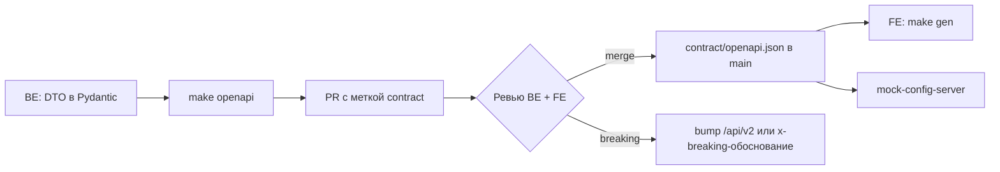

# 2–3. Контракт: процесс и сквозные решения

> Часть плана MVP. Навигация: [README](../../README.md) · [Контракт](README.md) · [API](api.md) · [Модель данных](data-model.md) · [Задачи](../tasks/README.md) · [Поставка](../delivery.md)

## 2. Contract-first: процесс и гейты

**Единственный источник правды — Pydantic-модели в `backend/`.** Снапшот `contract/openapi.json` коммитится; фронтенд генерирует из него клиент.

Поток изменения:



Правила:

| #   | Правило                                                                                          |
| --- | ------------------------------------------------------------------------------------------------ |
| C-1 | Фронтенд **не редактирует** сгенерированный клиент и не пишет DTO руками                             |
| C-2 | Контракт меняется только в PR с меткой `contract`; нужен approve от FE и BE                            |
| C-3 | Удаление/переименование поля, смена типа, новый обязательный request-параметр = **breaking**           |
| C-4 | Аддитивные изменения (новое опциональное поле, новый эндпоинт) — без смены версии                      |
| C-5 | `contract/openapi.json` расходится с кодом → CI красный (`git diff --exit-code`)                      |
| C-6 | Каждая операция обязана иметь: `summary`, `tags`, все `responses` (включая 4xx), примеры (CT-08)        |
| C-7 | FE разблокирован с первого дня: mock-config-server по снапшоту (CT-06)                                |

CI-гейты (job `contract`):

```bash
make openapi                 # backend: python -m app.scripts.export_openapi > contract/openapi.json
git diff --exit-code contract/openapi.json
oasdiff breaking contract/openapi.json@main contract/openapi.json   # падает → метка breaking-contract
pnpm --dir frontend gen:api && git diff --exit-code frontend/generated  # кодогенерация детерминирована
schemathesis run contract/openapi.json --url http://api:8000 --checks all   # в integration job
```

### 2.1. Frontend-first: UI раньше backend

Порядок внутри каждой фазы: **контракт → фронтенд на моке → backend**. Фронтенд не ждёт backend и не держит фикстур в компонентах: он ходит через сгенерированный клиент в mock-config-server, затем переключается на реальный API через прокси/env.

| Шаг | Событие                                                            | Артефакт               |
| --- | ------------------------------------------------------------------ | ---------------------- |
| 1   | Операция и DTO появляются в скелете контракта (тело может быть 501) | `contract/openapi.json` |
| 2   | `mock-server.config.ts` отвечает по путям и схемам контракта          | CT-06                  |
| 3   | Тот же конфиг держит состояние (вход, бронь, отмена, ошибки)         | CT-09                  |
| 4   | FE собирает экран и e2e на моке                                     | `FE-*`                 |
| 5   | BE реализует операцию; schemathesis подтверждает соответствие       | `BE-*`                 |
| 6   | FE переключается на реальный API; e2e повторяется в режиме `real`    | FE-QA-01               |

Правила frontend-first:

- Экран можно начинать, когда операция есть в снапшоте контракта; реализация backend не требуется.
- Данные в UI приходят только из мока или API: массивов-заглушек в компонентах нет.
- Мок отвечает на все реализованные пути контракта; ошибки (401/403/409/422/429) возвращаются как `application/problem+json`.
- Сценарии ошибок задаются данными запроса (занятый слот, истёкший дедлайн), а не правкой компонентов.
- Nuxt проксирует `/api` на мок в dev (`nitro.devProxy`); переключение на backend — одна переменная окружения.
- Фаза закрывается только после e2e в двух режимах: `mock` (без БД, минуты) и `real` (полный стек).

## 3. Сквозные решения контракта

| ID   | Тема                 | Решение                                                                                      |
| ---- | -------------------- | -------------------------------------------------------------------------------------------- |
| D-01 | Тенант               | Тенант определяется по `Host`; `X-Tenant` — только dev/test; `tenant_id` никогда не в теле запроса |
| D-02 | Пути и версии        | `/api/v1/{public,me,admin,platform}`; breaking-изменения → `/api/v2`                            |
| D-03 | Аутентификация       | Access JWT 15 мин в памяти; refresh — в `__Host-rt` (HttpOnly/Secure/SameSite=Lax), ротация     |
| D-04 | 2FA                  | TOTP обязателен для `owner`/`admin`; `mfa_token` 5 мин; 10 recovery-кодов                      |
| D-05 | Время                | Всё в UTC ISO-8601 (`Z`), `timestamptz`; интервалы полуоткрытые `[start, end)`                  |
| D-06 | Деньги               | `price_minor` (int) + `currency` тенанта; цену считает только сервер                           |
| D-07 | Списки               | `limit` (20, max 100) + `offset` + `sort`; ответ `{items,total,limit,offset}`; неизвестный фильтр → 422 |
| D-08 | Идемпотентность      | `Idempotency-Key` обязателен на создающих операциях (список ниже), TTL 24 ч                     |
| D-09 | Версии записей       | `version:int` в admin-DTO; несовпадение → 409 `stale_version`                                   |
| D-10 | Файлы                | `POST /files` → `file_id`; приватный/публичный бакет; привязка через `attachment`              |
| D-11 | Занятость            | Единая таблица `occupancy` + EXCLUDE-constraint; пересечение → 409 `slot_taken`                 |
| D-12 | Политики             | `tenant_settings`: горизонт, мин/макс длительность, отмена, напоминание, лимиты                 |
| D-13 | Уведомления          | Outbox в транзакции события; критичные — email+push; прочие — push→email                        |
| D-14 | Аналитика            | Метрики по `start_time` аренды, бакеты по таймзоне тенанта; формулы в `contract/analytics.md`   |
| D-15 | Кэш                  | `public`: ETag + `max-age`; `me`/`admin`: `no-store`                                            |
| D-16 | Трассировка          | `X-Request-Id` (генерируется/пробрасывается) → `trace_id` в любой ошибке                        |
| D-17 | Enum-ы               | Строковые snake_case; значения — в §3.9; неизвестное значение клиент показывает как есть         |
| D-18 | URL и SSR            | Человекочитаемые `slug` для tenant/category/lot; SSR-кэш ключуется по `host`                     |

### 3.1. Резолвинг тенанта (D-01)

1. `Host` → `tenant` (уникальные `subdomain` и `domain`); ответ 404 `tenant_not_found`, если не найден.
2. JWT содержит `tnt`; несовпадение с `Host` → 403 `tenant_mismatch` (защита от переноса токена).
3. RLS: `SET LOCAL app.tenant_id` в начале транзакции (SQLAlchemy event `after_begin`); воркер/миграции — `app.bypass_rls`.
4. Nuxt SSR обязан пробрасывать `host` и `cookie` в исходящие запросы; SSR-кэш — по `host+path`, никакого общего кэша между тенантами.

### 3.2. Аутентификация (D-03, D-04)

| Свойство         | Значение                                                              |
| ---------------- | --------------------------------------------------------------------- |
| Access token     | 15 мин, `HS256`/`EdDSA`, claims: `sub`, `tnt`, `role`, `ver`, `jti`, `exp` |
| Refresh          | 30 дней, ротация при каждом `/auth/refresh`, detection повторного использования → отзыв всей сессии |
| Cookie           | `__Host-rt`; `HttpOnly; Secure; SameSite=Lax; Path=/`                  |
| CSRF             | Проверка `Origin`/`Sec-Fetch-Site` для всех небезопасных методов + точный CORS-origin |
| Пароль           | argon2id; минимум 8 символов; «утечка в списке» → 422                    |
| MFA              | TOTP 30 с, ±1 окно, lockout 5 попыток/5 мин; recovery-код одноразовый   |
| Сброс пароля     | Токен 1 ч, одноразовый; после сброса все refresh-сессии отозваны        |

Пример логина с MFA:

```json
POST /api/v1/auth/login  →  200 {"mfa_required": true, "mfa_token": "..."}
POST /api/v1/auth/mfa/verify {"mfa_token": "...", "code": "123456"}
                         →  200 {"access_token": "...", "expires_in": 900, "user": {...}}
```

### 3.3. Роли и права

Иерархия: `owner` ⊃ `admin` ⊃ `user`. Гость — без токена.

| Право (`permissions[]` из `/auth/session`) | owner | admin | user |
| ------------------------------------------ | :---: | :---: | :--: |
| `catalog.manage` (категории, лоты, файлы лотов) | ✅ | ❌ | ❌ |
| `settings.manage` (политики тенанта) | ✅ | ❌ | ❌ |
| `admins.manage` | ✅ | ❌ | ❌ |
| `offers.manage` | ✅ | ❌ | ❌ |
| `calendar.view` / `calendar.block` | ✅ | ✅ | ❌ |
| `verification.review` | ✅ | ✅ | ❌ |
| `tickets.manage` | ✅ | ✅ | ❌ |
| `rentals.manage` | ✅ | ✅ | ❌ |
| `analytics.view` | ✅ | ✅ | ❌ |
| `audit.view` | ✅ | ❌ | ❌ |

| Область путей        | Гость | user | admin | owner |
| -------------------- | :---: | :--: | :---: | :---: |
| `/public/*`          | ✅ | ✅ | ✅ | ✅ |
| `/auth/{register,login,mfa/verify,refresh,logout,password/*}` | ✅ | ✅ | ✅ | ✅ |
| `/me/*`, `/files`    | ❌ | ✅ | ✅ | ✅ |
| `/admin/catalog/*`, `/admin/settings`, `/admin/offers`, `/admin/users` | ❌ | ❌ | ❌ | ✅ |
| `/admin/{calendar,rentals,tickets,verification-requests,analytics}` | ❌ | ❌ | ✅ | ✅ |
| `/admin/audit-log`   | ❌ | ❌ | ❌ | ✅ |

### 3.4. Ошибки (RFC 9457)

```json
{
  "type": "urn:keeprollin:error:slot_taken",
  "title": "Слот занят",
  "status": 409,
  "code": "slot_taken",
  "detail": "Лот занят в интервале 2026-11-05T14:00Z–2026-11-05T18:00Z",
  "trace_id": "01J9Z5V3T0K8R2",
  "fields": {"start_time": "пересекается с существующей арендой"}
}
```

Клиент показывает текст из `code` → i18n; `detail` — только для разработки.

| Код                       | HTTP | Когда                                                         |
| ------------------------- | :--: | ------------------------------------------------------------- |
| `validation_error`        | 422  | DTO/фильтры невалидны (есть `fields`)                          |
| `invalid_credentials`     | 401  | Неверный email/пароль                                          |
| `invalid_mfa_code`        | 401  | Неверный/просроченный TOTP или recovery-код                    |
| `token_invalid` / `token_expired` | 401 | Access/refresh токен                                          |
| `session_revoked`         | 401  | Повторное использование refresh (reuse detection)              |
| `forbidden_role`          | 403  | Нет права на операцию                                          |
| `tenant_mismatch`         | 403  | Токен другого тенанта                                          |
| `verification_required`   | 403  | Бронь/тикет без одобренной верификации                         |
| `offer_not_accepted`      | 403  | Нет принятия активной версии оферты                            |
| `not_found`               | 404  | Объект не существует или недоступен (IDOR неотличим)           |
| `tenant_not_found`        | 404  | Host не соответствует тенанту                                  |
| `slot_taken`              | 409  | Пересечение с бронью/блокировкой/обслуживанием                 |
| `lot_unavailable`         | 409  | Лот `maintenance`/`overdue`/`archived`                         |
| `lot_has_active_rental`   | 409  | Попытка архивировать/блокировать занятый лот                   |
| `rental_not_active`       | 409  | Действие требует `active`/`overdue`                            |
| `rental_already_closed`   | 409  | Повторное закрытие аренды                                      |
| `cancellation_not_allowed`| 409  | Позже дедлайна отмены (policy тенанта)                         |
| `stale_version`           | 409  | `version` в запросе устарел (D-09)                             |
| `already_processed`       | 409  | Решение по заявке уже принято                                  |
| `characteristic_in_use`   | 409  | Смена типа/удаление характеристики с данными                   |
| `email_taken`             | 409  | Регистрация на занятый email                                   |
| `idempotency_conflict`    | 422  | Тот же ключ, другой body                                       |
| `upload_invalid`          | 422  | MIME/размер/назначение файла не валидны                        |
| `critical_channel_locked` | 422  | Попытка отключить критичное уведомление                        |
| `payload_too_large`       | 413  | Файл/тело больше лимита                                        |
| `unsupported_media_type`  | 415  | Неподдерживаемый тип                                           |
| `rate_limited`            | 429  | Лимит запросов (есть `Retry-After`)                            |
| `issue_limit_exceeded`    | 429  | > 5 тикетов на аренду в сутки                                  |
| `internal_error`          | 500  | Необработанная ошибка (с `trace_id`)                           |
| `service_unavailable`     | 503  | Зависимость (БД/S3/SMTP) недоступна                            |

### 3.5. Идемпотентность (D-08)

Заголовок `Idempotency-Key` (UUIDv4) обязателен для:

| Метод и путь                             |
| ---------------------------------------- |
| `POST /rentals`                          |
| `POST /me/rentals/{id}/tickets`          |
| `POST /me/verification-requests`         |
| `POST /admin/lots/bulk`                  |

Поведение: ключ хранится `(tenant_id, user_id, key)` + хеш body 24 ч. Повтор с тем же body → сохранённый ответ + `Idempotent-Replayed: true`; другой body → 422 `idempotency_conflict`.

### 3.6. Занятость и брони (D-11)

Единая таблица `occupancy(lot_id, kind, period tstzrange, ref_id, status)` с ограничением:

```sql
ALTER TABLE occupancy ADD CONSTRAINT occupancy_no_overlap
  EXCLUDE USING gist (lot_id WITH =, period WITH &&) WHERE (status = 'active');
```

* `kind ∈ {booking, block, maintenance}` — бронь, ручная блокировка (UC-2.4), обслуживание (UC-9.4).
* Пересечение на уровне БД → `IntegrityError` → 409 `slot_taken` (единственная защита от гонок, приложение не «проверяет и вставляет»).
* `status ∈ {active, released}` — отмена/закрытие освобождает интервал, история сохраняется.
* Просрочка (UC-10.4) не требует новой записи: `rental.status=overdue` при активном `occupancy` уже блокирует новые брони.

### 3.7. Доступность: форматы

```json
// GET /api/v1/public/lots/{slug}/availability?from=2026-11-05T00:00:00Z&to=2026-11-12T00:00:00Z
{
  "lot_id": "6f1c…", "from": "…", "to": "…",
  "busy": [{"start": "2026-11-05T14:00:00Z", "end": "2026-11-05T18:00:00Z", "kind": "busy"}],
  "next_free": {"start": "2026-11-05T18:00:00Z", "end": "2026-11-06T09:00:00Z"}
}
```

* Гость видит только `kind: "busy"`; staff — `booking|block|maintenance` + `rental_id`/`block_id`.
* Диапазон ≤ 90 дней; `from < to`; иначе 422.
* Агрегат по модели: `GET /public/availability?category_id=…` → `{lots_total, lots_free, windows: [...]}` (UC-2.2/7.1).

### 3.8. Лимиты и политики (`tenant_settings`, D-12)

| Параметр                    | Дефолт | Диапазон   | UC                    |
| --------------------------- | :----: | ---------- | --------------------- |
| `booking_horizon_days`      | 60     | 1–365      | UC-7.2                |
| `min_rental_minutes`        | 60     | 15–1440    | UC-7.2                |
| `max_rental_days`           | 30     | 1–90       | UC-7.2                |
| `cancellation_free_hours`   | 24     | 0–168      | UC-7.5, UC-1.7        |
| `reminder_hours_before`     | 1      | 1–72       | UC-8.2                |
| `tickets_per_rental_per_day`| 5      | 1–20       | UC-8.3 (E3)           |
| `lot_photos_max`            | 10     | 1–20       | UC-1.4                |
| `verification_docs_retention_days` | 90 | 30–365   | §9 Q4                 |
| `timezone`                  | —      | IANA       | отображение, аналитика |
| `currency`                  | RUB    | ISO 4217   | D-06                  |

Прочие лимиты контракта: описание тикета 10–1000 символов; фото ≤ 5 МБ (jpg/png/webp), документ ≤ 10 МБ (jpg/png/pdf); не более 3 фото на тикет и 3 документов на заявку; bulk-создание ≤ 50 лотов.

### 3.9. Enum-ы (D-17)

| Сущность       | Значения                                                                 |
| -------------- | ------------------------------------------------------------------------ |
| `user.role`    | `owner`, `admin`, `user`                                                 |
| `lot.status`   | `active`, `archived`, `maintenance`, `overdue`                           |
| `rental.status`| `booked`, `active`, `overdue`, `completed`, `cancelled`                  |
| `verification.status` | `pending`, `approved`, `rejected`                                 |
| `ticket.status`| `submitted`, `in_progress`, `resolved`                                   |
| `ticket.category` | `no_power`, `no_drive`, `battery`, `damage`, `other`                  |
| `occupancy.kind` | `booking`, `block`, `maintenance`                                      |
| `offer_version.status` | `draft`, `active`, `archived`                                   |
| `rental_model` | `hourly`, `daily`, `custom`                                              |
| `file.purpose` | `lot_photo`, `ticket_photo`, `verification_passport`, `verification_registration`, `verification_selfie` |
| `characteristic.type` | `number`, `text`, `select`                                        |
| `notification.status` | `pending`, `sent`, `failed`                                       |
| `audit.action` | фиксированный enum, пополняется миграцией: `lot.status_changed`, `rental.closed`, `rental.overdue`, `verification.decided`, `ticket.status_changed`, `offer.published`, `settings.updated`, `admin.created`, `admin.deactivated`, `lot.blocked` |

### 3.10. Уведомления: события (D-13)

| `event_type`               | Критичное | Каналы (порядок)      | Получатель |
| -------------------------- | :-------: | --------------------- | ---------- |
| `verification.approved`    | ❌        | push → email          | user       |
| `verification.rejected`    | ✅        | email + push          | user       |
| `booking.confirmed`        | ❌        | push → email          | user       |
| `booking.cancelled`        | ❌        | push → email          | user       |
| `rental.ending_soon`       | ❌        | push → email          | user       |
| `rental.overdue.user`      | ✅        | email + push          | user       |
| `rental.overdue.admin`     | ✅        | email + push          | admin+owner|
| `ticket.created.admin`     | ✅        | email + push          | admin+owner|
| `ticket.updated.user`      | ❌        | push → email          | user       |
| `ticket.resolved.user`     | ✅        | email + push          | user       |

Ключ дедупликации: `(event_type, entity_id, user_id, channel)`. Retry: 1/5/15 мин, затем `failed`.

Формат настроек пользователя (`GET/PUT /me/notification-preferences`):

```json
{
  "push_enabled": true,
  "email_by_event": {"booking.confirmed": true, "rental.ending_soon": true, "ticket.updated.user": false},
  "locked_events": ["verification.rejected", "rental.overdue.user", "ticket.resolved.user"]
}
```

### 3.11. Аналитика: определения (D-14)

| Метрика                | Формула                                                                 |
| ---------------------- | ----------------------------------------------------------------------- |
| `revenue_minor`        | Σ `rental.price_minor` где `status ∈ {active, overdue, completed}` и `start_time ∈ [from, to)` |
| `rentals_count`        | Кол-во аренд с `start_time ∈ [from, to)` (включая отменённые — отдельным полем) |
| `cancelled_count`      | Кол-во `cancelled` в периоде                                             |
| `overdue_count`        | Кол-во `overdue` в периоде                                               |
| `avg_rental_minor`     | `revenue_minor / rentals_count` (без отменённых)                         |
| `utilization_pct`      | `occupied_minutes / available_minutes × 100`; `available` = период × лоты, не находящиеся в `archived` на момент расчёта (ограничение MVP, зафиксировать) |
| Группировка            | `category`, `lot`, `day` (границы дня — в `tenant.timezone`)             |

Экспорт CSV (`GET /admin/analytics/export`): `text/csv; charset=utf-8`, BOM, разделитель `;`, защита от формул (`= + - @` экранируются), заголовки на русском.

### 3.12. Прочее

* `X-Request-Id` принимается от клиента/прокси, иначе генерируется; возвращается в ответе и попадает в `trace_id` любых ошибок.
* `Date`-заголовок ответа — источник для клиентского таймера (FE считает offset, не доверяет локальным часам).
* Кэш: `GET /public/tenant` → `max-age=300`; каталог/карточка → `max-age=60, stale-while-revalidate=300`; доступность → `max-age=10`; `/me` и `/admin` → `no-store`.
* Валюта одна на тенанта; мультивалютность — бэклог (ТЗ 12.1).
