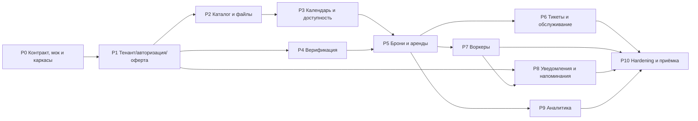

# 6. Задачи: индекс, фазы, порядок

> Часть плана MVP. Навигация: [README](../../README.md) · [Контракт](../contract/README.md) · [API](../contract/api.md) · [Модель данных](../contract/data-model.md) · [Задачи](README.md) · [Поставка](../delivery.md)

Задачи разбиты на подгруппы: **контракт → backend → frontend → окружение/приёмка**. Внутри подгруппы задачи упорядочены по зависимостям. Фазы, параллельные дорожки и гейты — §6.5 и §7. Каждый блок `### ID · Название` — отдельный issue.

Легенда: `CT-*` — контракт, `BE-*` — backend, `FE-*` — frontend, `QA-*` — сквозное.

**Индекс подгрупп**

| Подгруппа | ID | Задачи | Кол-во |
| --------- | -- | ------ | :----: |
| Решения, эндпоинты, снапшот | C1 | `CT-01`, `CT-02`, `CT-03` | 3 |
| Кодогенерация, mock, гейты, эволюция | C2 | `CT-04`, `CT-05`, `CT-06`, `CT-07`, `CT-08`, `CT-09` | 6 |
| Платформа, БД, RLS, тестовая база | B1 | `BE-00`, `BE-01`, `BE-02`, `BE-03` | 4 |
| Аутентификация, роли, 2FA | B2 | `BE-AUTH-01`, `BE-AUTH-02`, `BE-AUTH-03`, `BE-AUTH-04`, `BE-AUTH-05`, `BE-AUTH-06` | 6 |
| Тенант, настройки, администраторы, оферта | B3 | `BE-TEN-01`, `BE-TEN-02`, `BE-ADM-01`, `BE-OFF-01` | 4 |
| Каталог, файлы, доступность | B4 | `BE-CAT-01`, `BE-CAT-02`, `BE-LOT-01`, `BE-LOT-02`, `BE-LOT-03`, `BE-LOT-04`, `BE-FILE-01`, `BE-AVA-01`, `BE-AVA-02`, `BE-AVA-03`, `BE-AVA-04` | 11 |
| Верификация и аудит | B5 | `BE-VER-01`, `BE-VER-02`, `BE-VER-03`, `BE-VER-04` | 4 |
| Брони и аренды | B6 | `BE-BOOK-01`, `BE-BOOK-02`, `BE-BOOK-03`, `BE-BOOK-04`, `BE-BOOK-05` | 5 |
| Тикеты и обслуживание | B7 | `BE-TIC-01`, `BE-TIC-02`, `BE-TIC-03` | 3 |
| Уведомления и outbox | B8 | `BE-NOT-01`, `BE-NOT-02`, `BE-NOT-03`, `BE-NOT-04`, `BE-NOT-05` | 5 |
| Воркеры и фоновые переходы | B9 | `BE-WRK-01`, `BE-WRK-02`, `BE-WRK-03`, `BE-WRK-04` | 4 |
| Аналитика и экспорт | B10 | `BE-AN-01`, `BE-AN-02`, `BE-AN-03`, `BE-AN-04` | 4 |
| Безопасность и контрактные тесты | B11 | `BE-QA-01`, `BE-QA-02`, `BE-QA-03`, `BE-QA-04` | 4 |
| Платформа: каркас, API-слой, сессия, layout, UI-kit, PWA | F1 | `FE-00`, `FE-01`, `FE-02`, `FE-03`, `FE-04`, `FE-05` | 6 |
| Аутентификация, MFA, оферта | F2 | `FE-AUTH-01`, `FE-AUTH-02`, `FE-AUTH-03`, `FE-AUTH-04`, `FE-OFF-01`, `FE-OFF-02` | 6 |
| Тенант, брендинг, настройки, администраторы | F3 | `FE-TEN-01`, `FE-TEN-02`, `FE-ADM-01` | 3 |
| Каталог (публичный и админский) | F4 | `FE-CAT-01`, `FE-CAT-02`, `FE-LOT-01`, `FE-LOT-02`, `FE-LOT-03`, `FE-LOT-04` | 6 |
| Календарь и доступность | F5 | `FE-CAL-01`, `FE-CAL-02`, `FE-CAL-03` | 3 |
| Верификация и аудит | F6 | `FE-VER-01`, `FE-VER-02`, `FE-VER-03`, `FE-AUD-01` | 4 |
| Брони, аренды, системные состояния | F7 | `FE-BOOK-01`, `FE-BOOK-02`, `FE-BOOK-03`, `FE-WRK-01` | 4 |
| Тикеты | F8 | `FE-TIC-01`, `FE-TIC-02`, `FE-TIC-03` | 3 |
| Уведомления и push | F9 | `FE-NOT-01`, `FE-NOT-02`, `FE-NOT-03` | 3 |
| Аналитика | F10 | `FE-AN-01`, `FE-AN-02`, `FE-AN-03`, `FE-AN-04` | 4 |
| E2E, a11y, бюджет производительности | F11 | `FE-QA-01`, `FE-QA-02` | 2 |
| Окружение и seed | Q1 | `QA-00` | 1 |
| Приёмка MVP | Q2 | `QA-01` | 1 |

**Всего задач: 109** (контракт — 9, backend — 54, frontend — 44, окружение/приёмка — 2).

**Файлы задач**

| Файл | Дисциплина | Задач |
| ---- | ---------- | :---: |
| [`contract.md`](contract.md) | §6.1 Контракт | 8 |
| [`backend.md`](backend.md) | §6.2 Backend (FastAPI + PostgreSQL) | 54 |
| [`frontend.md`](frontend.md) | §6.3 Frontend (Nuxt 4 / Vue 3) | 44 |
| [`qa.md`](qa.md) | §6.4 Окружение и приёмка | 2 |

## 6.5. Распределение по фазам

Порядок исполнения сохраняется по фазам. Внутри фазы действует правило **frontend-first** (§2.1): `FE-*` стартует на моке, как только операция есть в контракте, и не блокируется реализацией `BE-*`.

| Фаза | Тема | Задачи | Гейт выхода |
| ---- | ---- | ------ | ----------- |
| P0 | Контракт, мок и каркасы | `CT-01`, `CT-02`, `CT-03`, `CT-04`, `CT-05`, `CT-06`, `CT-07`, `CT-08`, `CT-09`, `BE-00`, `BE-01`, `BE-02`, `BE-03`, `FE-00`, `FE-01`, `FE-02`, `FE-03`, `FE-04`, `FE-05`, `QA-00` | снапшот контракта содержит все операции; FE собирается на mock; сквозной сценарий проходит на stateful mock; e2e-smoke зелёный. |
| P1 | Тенант, аутентификация, оферта | `BE-AUTH-01`, `BE-AUTH-02`, `BE-AUTH-03`, `BE-AUTH-04`, `BE-AUTH-05`, `BE-AUTH-06`, `BE-TEN-01`, `BE-TEN-02`, `BE-ADM-01`, `BE-OFF-01`, `BE-NOT-01`, `FE-AUTH-01`, `FE-AUTH-02`, `FE-AUTH-03`, `FE-AUTH-04`, `FE-TEN-01`, `FE-TEN-02`, `FE-ADM-01`, `FE-OFF-01`, `FE-OFF-02` | сценарий «регистрация → MFA → оферта → сессия с правами» зелёный на моке и на реальном API; RLS и tenant-mismatch покрыты тестами. |
| P2 | Каталог | `BE-CAT-01`, `BE-CAT-02`, `BE-LOT-01`, `BE-LOT-02`, `BE-LOT-03`, `BE-LOT-04`, `BE-FILE-01`, `FE-CAT-01`, `FE-CAT-02`, `FE-LOT-01`, `FE-LOT-02`, `FE-LOT-03`, `FE-LOT-04` | owner создаёт категорию с характеристиками и лот; гость видит каталог и карточку в SSR; файлы не утекают между тенантами. |
| P3 | Календарь и доступность | `BE-AVA-01`, `BE-AVA-02`, `BE-AVA-03`, `BE-AVA-04`, `FE-CAL-01`, `FE-CAL-02`, `FE-CAL-03` | тест на гонку двух броней зелёный; календарь и доступность используют одну модель. |
| P4 | Верификация | `BE-VER-01`, `BE-VER-02`, `BE-VER-03`, `BE-VER-04`, `FE-VER-01`, `FE-VER-02`, `FE-VER-03`, `FE-AUD-01` | заявка проходит путь до решения и записи в outbox (`pending`); документы недоступны чужому пользователю (тест IDOR); фактическая доставка проверяется в P8. |
| P5 | Брони и аренды | `BE-BOOK-01`, `BE-BOOK-02`, `BE-BOOK-03`, `BE-BOOK-04`, `BE-BOOK-05`, `FE-BOOK-01`, `FE-BOOK-02`, `FE-BOOK-03` | бронь → аренда → закрытие на e2e; гонка броней покрыта тестом; цена нигде не приходит с клиента. |
| P6 | Тикеты и обслуживание | `BE-TIC-01`, `BE-TIC-02`, `BE-TIC-03`, `FE-TIC-01`, `FE-TIC-02`, `FE-TIC-03` | репорт из активной аренды попадает в очередь админа (outbox), лот уходит в обслуживание и пропадает из брони. |
| P7 | Воркеры: просрочка и переходы | `BE-WRK-01`, `BE-WRK-02`, `BE-WRK-04`, `FE-WRK-01` | прогон с «просрочкой» на seed-данных: статусы, записи в outbox, календарь и блокировка новых броней. |
| P8 | Уведомления и напоминания | `BE-WRK-03`, `BE-NOT-02`, `BE-NOT-03`, `BE-NOT-04`, `BE-NOT-05`, `FE-NOT-01`, `FE-NOT-02`, `FE-NOT-03` | все 10 событий проходят через MailHog; push проверен на Chrome + iOS PWA; fallback и напоминание об окончании подтверждены. |
| P9 | Аналитика | `BE-AN-01`, `BE-AN-02`, `BE-AN-03`, `BE-AN-04`, `FE-AN-01`, `FE-AN-02`, `FE-AN-03`, `FE-AN-04` | цифры дашборда совпадают с ручным расчётом на seed; CSV открывается в Excel. |
| P10 | Hardening и приёмка | `BE-QA-01`, `BE-QA-02`, `BE-QA-03`, `BE-QA-04`, `FE-QA-01`, `FE-QA-02`, `QA-01` | — |

## 7. Порядок и параллельные дорожки

Параллельные дорожки внутри фаз:

| Дорожка       | Кто             | Фазы                                                      |
| ------------- | --------------- | --------------------------------------------------------- |
| Контракт      | BE+FE (пара)    | P0; далее — владелец контракта на каждую фазу              |
| Backend core  | BE              | P0–P5 последовательно; P6, P7, P9 параллельно после P5     |
| Frontend      | FE              | P0 на моке; далее идёт впереди BE внутри фазы, приёмка — на реальном API |
| Уведомления   | BE (отдельный)  | P8 после P5: каналы + напоминания (`BE-WRK-03`)            |
| QA            | QA              | QA-00 в P0; e2e начинает накапливать с P2                  |

Правила синхронизации:
1. Фаза начинается, когда её `CT`-часть в контракте зафиксирована (эндпоинты и DTO), даже если BE ещё пишет логику.
2. FE не ждёт реализацию: mock + контракт = достаточно для вёрстки и e2e на mock.
3. Любая правка контракта внутри фазы — отдельный `contract` PR, не «попутно».

## 8. Definition of Ready / Done

**Задача готова (DoR):** есть `Зависит`, эндпоинты/поля в контракте, AC измеримы, затронутые UC указаны.

**Задача сделана (DoD):**
- [ ] Контракт не разошёлся (`contract` job зелёный).
- [ ] Unit/интеграционные тесты на новое поведение; AC покрыты.
- [ ] Ошибки возвращаются кодами из §3.4 (без «сырых» 400/500).
- [ ] Tenant-изоляция не нарушена (тест, если появился `{id}`).
- [ ] i18n-ключи добавлены; хардкод-строк нет.
- [ ] Логи/метрики для фоновой логики (если применимо).
- [ ] Документация обновлена (`contract/*`, если менялись решения).
- [ ] Smoke-проверка: изменённый путь открыт вручную (скрин/лог в задаче).
