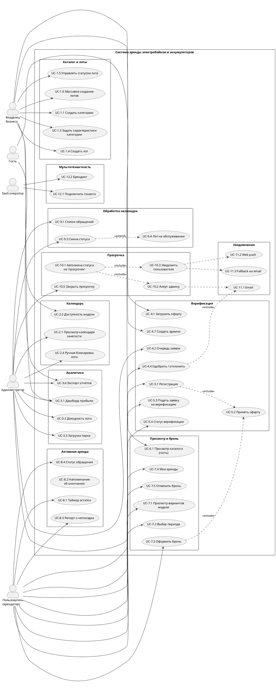

# Техническое задание: Система аренды электробайков и аккумуляторов (MVP)

**Версия:** 1.0  
**Тип продукта:** Коробочное SaaS-решение (white-label) с мультитенантностью  
**Статус:** Готово к передаче в разработку

---

## Оглавление

1. [Общее описание](#1-общее-описание)
2. [Глоссарий](#2-глоссарий)
3. [Акторы и роли](#3-акторы-и-роли)
4. [Ограничения MVP](#4-ограничения-mvp)
5. [Функциональные требования (Use-Cases)](#5-функциональные-требования-use-cases)
6. [Детализация ключевых сценариев](#6-детализация-ключевых-сценариев)
7. [Диаграмма Use-Case](#7-диаграмма-use-case)
8. [Модель данных (ER)](#8-модель-данных-er)
9. [Нефункциональные требования](#9-нефункциональные-требования)
10. [Архитектура и мультитенантность](#10-архитектура-и-мультитенантность)
11. [Уведомления](#11-уведомления)
12. [Бэклог (после MVP)](#12-бэклог-после-mvp)
13. [Открытые вопросы](#13-открытые-вопросы)

---

## 1. Общее описание

### 1.1. Назначение

Система предназначена для бизнеса по аренде электробайков и аккумуляторов. Владелец бизнеса (тенант) управляет каталогом, лотами, расписанием, верификацией пользователей и аналитикой. Пользователи регистрируются, проходят верификацию, бронируют лоты и сообщают о неполадках.

### 1.2. Модель поставки

**Коробочный SaaS (white-label):** каждая компания-клиент подключается к платформе как отдельный тенант со своим доменом/поддоменом, брендингом и изолированными данными. Один экземпляр системы обслуживает множество независимых бизнесов.

### 1.3. Целевая платформа

Адаптивное веб-приложение (mobile-first). Нативные мобильные приложения — в бэклоге.

---

## 2. Глоссарий

| Термин                       | Определение                                                                    |
| ---------------------------- | ------------------------------------------------------------------------------ |
| **Тенант**                   | Отдельная компания-клиент, использующая систему (изолированное пространство)   |
| **Владелец бизнеса**         | Супер-пользователь тенанта, управляющий каталогом, лотами, офертой, аналитикой |
| **Администратор**            | Сотрудник тенанта: верификация пользователей, календарь, обработка обращений   |
| **Пользователь (арендатор)** | Клиент, арендующий лоты                                                        |
| **Гость**                    | Незарегистрированный посетитель                                                |
| **Категория**                | Группа товаров (например, «Электробайки», «Аккумуляторы»)                      |
| **Характеристика**           | Произвольный атрибут категории (мощность, разгон, ёмкость и т.д.)              |
| **Лот**                      | Конкретный экземпляр товара, доступный для аренды                              |
| **Модель аренды**            | Почасовая (по умолчанию), посуточная, кастомная — атрибут лота                 |
| **Бронь**                    | Резервирование лота пользователем на период                                    |
| **Аренда**                   | Активный период использования лота                                             |
| **Тикет**                    | Обращение пользователя о технической неполадке                                 |
| **Оферта**                   | Пользовательское соглашение, версионируемое                                    |

---

## 3. Акторы и роли

| Актор                | Описание                   | Права                                                             |
| -------------------- | -------------------------- | ----------------------------------------------------------------- |
| **Владелец бизнеса** | Супер-пользователь тенанта | Каталог, лоты, оферта, аналитика, управление админами             |
| **Администратор**    | Сотрудник тенанта          | Верификация, календарь, аналитика, обработка неполадок, просрочек |
| **Пользователь**     | Верифицированный арендатор | Просмотр, бронь, активная аренда, репорт о неполадках             |
| **Гость**            | Незарегистрированный       | Просмотр каталога и календаря доступности                         |
| **SaaS-оператор**    | Владелец платформы         | Подключение тенантов, брендинг (вне MVP)                          |
| **Система (cron)**   | Фоновый воркер             | Автосмена статусов, рассылка уведомлений                          |

---

## 4. Ограничения MVP

| Параметр           | Решение                                                         |
| ------------------ | --------------------------------------------------------------- |
| Оплата             | ❌ Нет в MVP, ✅ в бэклоге                                      |
| Модель аренды      | Почасовая (основная), переопределяется на уровне лота           |
| Оферта             | Предоставляется заказчиком, загружается админом, версионируется |
| Мультитенантность  | ✅ Отдельный домен/поддомен на тенанта                          |
| Промежуточные роли | ❌ Нет (только Владелец, Админ, Пользователь)                   |
| Уведомления        | Email + Web push (с fallback на email)                          |
| Клиент             | Адаптивный веб (mobile-first), без нативных приложений          |
| Интеграции         | ❌ Нет в MVP (GPS, карты, бухгалтерия — бэклог)                 |
| Продление аренды   | ❌ Бэклог                                                       |
| Фото в репорте     | Опционально (до 3 шт.)                                          |
| Просрочка          | ✅ Алерт админу + автосмена статуса                             |
| Гость              | ✅ Просмотр каталога и календаря                                |
| Push               | ✅ Web push + fallback на email                                 |
| SLA по обращениям  | ❌ Не нужно                                                     |

---

## 5. Функциональные требования (Use-Cases)

### 5.1. Управление каталогом (Владелец)

- **UC-1.1** Создать категорию товаров
- **UC-1.2** Редактировать / архивировать категорию
- **UC-1.3** Задать произвольные характеристики категории (название, тип, единица, обязательность)
- **UC-1.4** Создать лот: экземпляр + значения характеристик + модель аренды + цена + фото + описание
- **UC-1.5** Редактировать лот / сменить статус (активен / архив / на обслуживании / просрочен)
- **UC-1.6** Массовое создание однотипных лотов
- **UC-1.7** Задать правила отмены брони

### 5.2. Календарь и расписание (Владелец / Админ)

- **UC-2.1** Просмотр календаря занятости (mobile-first): свободен / забронирован / в аренде / на обслуживании / просрочен
- **UC-2.2** Просмотр доступности модели («3 из 4 свободны, ближайшее окно 14:00–18:00»)
- **UC-2.3** Фильтрация по категории / лоту / периоду / статусу
- **UC-2.4** Ручная блокировка лота
- **UC-2.5** Адаптивный вид для смартфона (свайп по датам, компактные карточки)

### 5.3. Аналитика (Владелец / Админ)

- **UC-3.1** Дашборд общей прибыли за период с разбивкой по категориям
- **UC-3.2** Отчёт по доходности конкретного лота
- **UC-3.3** Отчёт по загрузке парка
- **UC-3.4** Экспорт отчётов (CSV/PDF)
- **UC-3.5** Сравнение периодов

### 5.4. Верификация и оферта (Админ / Владелец)

- **UC-4.1** Загрузить / обновить текст оферты (версионирование)
- **UC-4.2** Просмотр очереди заявок на верификацию
- **UC-4.3** Просмотр заявки (паспорт + фото)
- **UC-4.4** Одобрить / отклонить с комментарием
- **UC-4.5** Повторная верификация после отклонения
- **UC-4.6** Журнал действий администратора (аудит)
- **UC-4.7** Создание администратора (только Владелец) с доп. подтверждением
- **UC-4.8** Email/push-уведомление пользователю о решении

### 5.5. Пользователь: регистрация и верификация

- **UC-5.1** Регистрация (email/телефон + пароль)
- **UC-5.2** Принятие оферты (чек-бокс, фиксация версии и даты)
- **UC-5.3** Подача заявки на верификацию (паспорт, селфи, данные)
- **UC-5.4** Отслеживание статуса верификации
- **UC-5.5** Ограничение до верификации: каталог — можно, бронь — нельзя

### 5.6. Гость: просмотр без регистрации

- **UC-6.1** Просмотр каталога и фильтров по характеристикам
- **UC-6.2** Просмотр карточки лота
- **UC-6.3** Просмотр календаря доступности модели (только временные окна, без персональных данных)
- **UC-6.4** CTA на регистрацию при попытке забронировать

### 5.7. Пользователь: бронирование

- **UC-7.1** Просмотр всех доступных вариантов одной модели с разными окнами
- **UC-7.2** Выбор периода с проверкой пересечений в реальном времени
- **UC-7.3** Оформление брони (без оплаты в MVP) + подтверждение по email/push
- **UC-7.4** Просмотр своих аренд (активные, история, статус)
- **UC-7.5** Отмена брони по правилам владельца

### 5.8. Пользователь: активная аренда

- **UC-8.1** Просмотр остатка времени аренды (таймер, прогресс-бар, дата/время окончания)
- **UC-8.2** Push/email-напоминание за N часов до окончания
- **UC-8.3** Сообщить о технической неполадке
- **UC-8.4** Просмотр статуса обращения

### 5.9. Обработка неполадок (Админ)

- **UC-9.1** Просмотр списка обращений (фильтры: статус, лот, дата)
- **UC-9.2** Просмотр карточки обращения
- **UC-9.3** Смена статуса + комментарий
- **UC-9.4** Перевод лота в «на обслуживании» с блокировкой в календаре
- **UC-9.5** Уведомление пользователя о решении

### 5.10. Просрочка аренды (Система)

- **UC-10.1** Автоматическая смена статуса на «просрочен»
- **UC-10.2** Алерт админу (email + push)
- **UC-10.3** Уведомление пользователю (email + push, fallback email)
- **UC-10.4** Отображение просрочки в календаре (отдельный цвет, блокирует новые брони)
- **UC-10.5** Ручное закрытие просрочки админом

### 5.11. Уведомления (сквозной модуль)

- **UC-11.1** Email-уведомления: верификация, бронь, окончание аренды, просрочка, ответ по неполадке
- **UC-11.2** Web push: те же события + напоминание об окончании
- **UC-11.3** Fallback на email при недоступности push
- **UC-11.4** Настройка пользователем типов уведомлений

### 5.12. Мультитенантность / White-label (SaaS-оператор)

- **UC-12.1** Подключение тенанта (изолированное пространство + отдельный домен/поддомен)
- **UC-12.2** Брендинг тенанта (лого, цвета)
- **UC-12.3** Изоляция данных между тенантами
- **UC-12.4** (Будущее) Тарифы и биллинг

---

## 6. Детализация ключевых сценариев

### 6.1. UC-8.3 «Сообщить о технической неполадке»

**Актор:** Пользователь (верифицированный, с активной арендой)  
**Триггер:** Пользователь обнаружил неисправность лота во время аренды

**Предусловия:**

- Пользователь авторизован и верифицирован
- У пользователя есть активная аренда (статус `active`)

**Постусловия (успех):**

- Создан тикет со статусом `submitted`
- Админу отправлено email/push-уведомление
- Пользователь видит тикет в списке обращений

**Основной поток:**

1. Пользователь открывает «Мои аренды» → активная аренда.
2. Нажимает «Сообщить о неполадке».
3. Система показывает форму:
   - лот (предзаполнен, заблокирован)
   - категория проблемы (radio: не включается / не едет / аккумулятор / повреждение / другое)
   - текстовое описание (обязательное, 10–1000 символов)
   - фото (опционально, до 3 шт., ≤ 5 МБ каждое, jpg/png)
4. Пользователь заполняет и нажимает «Отправить».
5. Система валидирует поля.
6. Система создаёт тикет: `id`, `rental_id`, `lot_id`, `user_id`, `category`, `description`, `photos[]`, `status=submitted`, `created_at`.
7. Система отправляет уведомление админу (email + push; при недоступности push — только email).
8. Пользователю показывается подтверждение «Обращение №X принято».

**Альтернативные потоки:**

- **A1.** Нет активной аренды → кнопка не отображается.
- **A2.** Описание слишком короткое → ошибка валидации.
- **A3.** Фото слишком большое / неверный формат → ошибка, предложение заменить файл.
- **A4.** Ошибка загрузки фото → фото пропускаются, тикет создаётся без них (с предупреждением).
- **A5.** Сбой отправки уведомления админу → тикет создаётся, уведомление ставится в очередь повторной отправки (retry 3×).

**Исключения:**

- **E1.** Пользователь не верифицирован → 403, редирект на верификацию.
- **E2.** Аренда уже завершена между шагами 1 и 4 → 409, форма закрывается.
- **E3.** Превышен лимит обращений (> 5 в сутки на аренду) → 429.

---

### 6.2. UC-10 «Просрочка аренды»

**Актор (системный):** Cron-воркер (каждую минуту)  
**Триггер:** `now > rental.end_time` и `rental.status = active`

**Предусловия:** аренда активна, время окончания прошло

**Постусловия:**

- `rental.status = overdue`
- `lot.status = overdue` (блокирует новые брони)
- Админу отправлен алерт (email + push)
- Пользователю отправлено уведомление (email + push, fallback email)
- Запись в аудит

**Основной поток:**

1. Cron каждую минуту выбирает аренды с `status=active AND end_time < now()`.
2. Для каждой аренды (идемпотентно, с `SELECT ... FOR UPDATE`):
   1. `rental.status ← overdue`
   2. `lot.status ← overdue`
   3. Создать запись в `notifications_outbox` для админа (email + push).
   4. Создать запись в `notifications_outbox` для пользователя (email + push, fallback email).
   5. Записать в `audit_log`: событие `rental.overdue`.
3. Outbox-воркер рассылает уведомления (retry 3×, экспоненциальный backoff).
4. В календаре лот отображается красным, новые брони невозможны.

**Альтернативные потоки:**

- **A1.** Уведомление не доставлено → повтор 3×, затем `failed`, админ видит в логе.
- **A2.** Пользователь возвращает лот после просрочки → админ вручную закрывает (UC-10.5): `rental.status ← completed`, `lot.status ← available`.
- **A3.** Просрочка > 24 ч → эскалация: повторный алерт админу.

**Исключения:**

- **E1.** Гонка с продлением/отменой → блокировка строки + проверка статуса.
- **E2.** Cron упал → идемпотентность + алерт мониторинга.

---

### 6.3. UC-7.3 «Оформление брони»

**Актор:** Пользователь (верифицированный)  
**Триггер:** Пользователь выбрал лот и период

**Предусловия:**

- Пользователь верифицирован
- Принял актуальную версию оферты
- Лот активен и свободен в выбранный период

**Постусловия (успех):**

- Создана бронь со статусом `booked`
- Лот заблокирован в календаре на период
- Пользователю отправлено подтверждение (email + push)
- Запись в аудит

**Основной поток:**

1. Пользователь выбирает лот и период в карточке.
2. Система проверяет пересечения с существующими бронями (`SELECT ... FOR UPDATE` на лот).
3. Система рассчитывает стоимость (цена × кол-во часов/дней).
4. Пользователь подтверждает.
5. Система создаёт бронь: `id`, `user_id`, `lot_id`, `start_time`, `end_time`, `price`, `status=booked`.
6. Лот блокируется на период в календаре.
7. Отправляется подтверждение (email + push).
8. Пользователь видит бронь в «Мои аренды».

**Альтернативные потоки:**

- **A1.** Пересечение с другой бронью → 409, предложение выбрать другое окно.
- **A2.** Лот переведён в «на обслуживании» между шагами 1 и 2 → 409, лот скрывается.
- **A3.** Пользователь не принял оферту → редирект на принятие.

**Исключения:**

- **E1.** Пользователь не верифицирован → 403.
- **E2.** Ошибка создания брони → транзакция откатывается, 500.

---

### 6.4. UC-4.4 «Одобрить / отклонить верификацию»

**Актор:** Администратор  
**Триггер:** Админ открыл заявку из очереди

**Предусловия:** заявка в статусе `pending`

**Постусловия (успех):**

- Заявка `approved` или `rejected` (с комментарием)
- Пользователю отправлено уведомление (email + push)
- Запись в аудит

**Основной поток:**

1. Админ открывает очередь заявок (UC-4.2).
2. Выбирает заявку → видит паспортные данные + фото + версию оферты.
3. Нажимает «Одобрить» или «Отклонить» (с обязательным комментарием).
4. Система меняет статус заявки и пользователя (`user.verification_status`).
5. Система отправляет уведомление пользователю (критичное событие → email + push).
6. Запись в `audit_log`: кто, когда, какое решение.

**Альтернативные потоки:**

- **A1.** Фото нечитаемо → админ запрашивает повторную заявку (статус `rejected`, комментарий «загрузите чёткое фото»).
- **A2.** Данные не совпадают → отклонение с комментарием.

**Исключения:**

- **E1.** Заявка уже обработана другим админом → 409, обновление страницы.

---

## 7. Диаграмма Use-Case



---

## 8. Модель данных (ER)

### 8.1. Основные сущности

```
tenant (тенант)
  id, name, domain, subdomain, logo_url, colors, created_at

user
  id, tenant_id, email, phone, password_hash, role (owner/admin/user),
  verification_status (pending/approved/rejected), created_at, is_2fa_enabled

verification_request
  id, user_id, passport_data (jsonb), photo_urls (jsonb), status,
  admin_comment, reviewed_by, reviewed_at, created_at

offer_version
  id, tenant_id, version, content (text), published_at, is_active

offer_acceptance
  id, user_id, offer_version_id, accepted_at, ip_address

category
  id, tenant_id, name, description, is_archived

characteristic
  id, category_id, name, type (number/text/select), unit, is_required, options (jsonb)

lot
  id, tenant_id, category_id, name, description, photo_urls (jsonb),
  characteristics (jsonb), rental_model (hourly/daily/custom), price,
  status (active/archived/maintenance/overdue), created_at

rental
  id, tenant_id, user_id, lot_id, start_time, end_time, price,
  status (booked/active/overdue/completed/cancelled), created_at, closed_at

ticket
  id, tenant_id, rental_id, lot_id, user_id, category (enum), description,
  photo_urls (jsonb), status (submitted/in_progress/resolved), admin_comment,
  created_at, resolved_at

notification_outbox
  id, tenant_id, user_id, event_type, channels (jsonb: [email, push]),
  payload (jsonb), status (pending/sent/failed), retry_count, created_at, sent_at

push_subscription
  id, user_id, endpoint, keys (jsonb), created_at, is_active

audit_log
  id, tenant_id, actor_id, actor_role, action, entity_type, entity_id,
  metadata (jsonb), created_at
```

### 8.2. Связи (ключевые)

- `tenant` 1—N `user`, `category`, `lot`, `rental`, `ticket`
- `category` 1—N `characteristic`, 1—N `lot`
- `user` 1—N `verification_request`, `rental`, `ticket`, `offer_acceptance`, `push_subscription`
- `lot` 1—N `rental`, `ticket`
- `rental` 1—N `ticket`
- `offer_version` 1—N `offer_acceptance`

### 8.3. Изоляция данных

Все таблицы содержат `tenant_id`. Row-Level Security (RLS) на уровне PostgreSQL или фильтрация на уровне приложения. Отдельный домен/поддомен → маршрутизация на тенанта.

---

## 9. Нефункциональные требования

### 9.1. Производительность

- Отклик API: p95 ≤ 300 мс для чтения, ≤ 500 мс для записи.
- Календарь: загрузка ≤ 1 с на мобильном 3G.
- Cron просрочки: каждую минуту, обработка до 10 000 аренд без деградации.

### 9.2. Доступность

- SLA 99.5% (MVP).
- Резервное копирование БД ежедневно.

### 9.3. Безопасность

- Пароли: bcrypt/argon2.
- 2FA для Владельца и Админа.
- HTTPS обязателен.
- Загрузка фото: проверка MIME, лимит размера, антивирус-скан (опционально).
- Аудит всех действий админов/владельцев.
- RLS для изоляции тенантов.

### 9.4. Совместимость

- Адаптивный веб: Chrome, Safari, Firefox, Edge (последние 2 версии).
- Mobile-first: iOS Safari, Android Chrome.
- Web push: Chrome, Firefox, Edge; iOS Safari — только PWA (fallback email).

### 9.5. Локализация

- Русский язык (MVP). Архитектурно — готовность к i18n.

### 9.6. Мониторинг

- Логирование ошибок (Sentry или аналог).
- Метрики: cron-задачи, outbox-очередь, ошибки API.
- Алерты: падение cron > 5 мин, outbox > 100 failed.

---

## 10. Архитектура и мультитенантность

### 10.1. Модель изоляции

**Вариант A (рекомендуемый для MVP):** Shared DB, `tenant_id` + RLS.  
**Вариант B (для крупных тенантов):** Schema-per-tenant.

Маршрутизация по домену/поддомену → определение `tenant_id` → контекст запроса.

### 10.2. Компоненты

- **Web API** (REST/GraphQL) — бизнес-логика.
- **Cron-воркер** — просрочки, напоминания.
- **Outbox-воркер** — рассылка уведомлений (email + push).
- **БД** (PostgreSQL) — данные + RLS.
- **Object Storage** (S3-совместимое) — фото (лоты, верификация, тикеты).
- **Email-провайдер** (SendGrid / SES / аналог).
- **Push-сервис** (Web Push API + VAPID).

### 10.3. Схема взаимодействия (упрощённо)

```
[Браузер] ⇄ [CDN/WAF] ⇄ [Web API] ⇄ [PostgreSQL]
                              ⇄ [Object Storage]
                              → [Outbox] → [Email/Push]
[Cron] → [PostgreSQL]
```

---

## 11. Уведомления

### 11.1. Логика выбора канала (UC-11.3)

```
1. Поддерживает ли браузер Push API?
   - нет → только email
2. Дано ли разрешение на push?
   - нет → только email
3. Активна ли push-подписка?
   - нет → только email
4. Отправить push.
5. Если push вернул 410/404 → инвалидировать подписку → email.
6. Если push успешен → email НЕ отправляется (кроме критичных событий).
```

### 11.2. Критичные события (всегда email + push)

- Просрочка аренды
- Отклонение верификации
- Ответ по обращению о неполадке

### 11.3. Некритичные события (push, fallback email)

- Напоминание об окончании аренды (за N часов)
- Подтверждение брони
- Одобрение верификации
- Смена статуса обращения о неполадке (в работе)

### 11.4. Настройка пользователем (UC-11.4)

- Пользователь может отключить не критичные уведомления (email/push отдельно).
- **Критичные уведомления отключить нельзя** (просрочка, отклонение верификации, ответ по обращению).
- Настройки хранятся в `user.notification_preferences (jsonb)`.

### 11.5. Формат уведомлений

| Событие                    | Канал        | Шаблон                                                      |
| -------------------------- | ------------ | ----------------------------------------------------------- |
| Верификация одобрена       | push → email | «Ваша заявка одобрена. Теперь вы можете бронировать»        |
| Верификация отклонена      | email + push | «Заявка отклонена. Причина: {comment}»                      |
| Бронь подтверждена         | push → email | «Бронь №{id} на {lot} с {start} по {end} подтверждена»      |
| Напоминание об окончании   | push → email | «Аренда заканчивается через {N} ч. Не забудьте вернуть лот» |
| Просрочка (пользователю)   | email + push | «Аренда просрочена. Верните лот как можно скорее»           |
| Просрочка (админу)         | email + push | «Лот {lot} просрочен пользователем {user}»                  |
| Тикет создан (админу)      | email + push | «Новое обращение №{id} по лоту {lot}: {category}»           |
| Тикет решён (пользователю) | email + push | «Обращение №{id} решено: {comment}»                         |

### 11.6. Техническая реализация

- **Outbox-паттерн:** все уведомления пишутся в `notification_outbox` в той же транзакции, что и бизнес-событие. Отдельный воркер рассылает.
- **Retry:** 3 попытки с экспоненциальным backoff (1 мин, 5 мин, 15 мин).
- **Идемпотентность:** уникальный ключ `(event_type, entity_id, user_id, channel)` — защита от дублей.
- **Email:** SendGrid / Amazon SES (шаблоны с подстановкой переменных).
- **Web Push:** VAPID-ключи на тенанта, `push_subscription` хранит endpoint + keys.
- **Инвалидация подписок:** при ответе 410/404 подписка помечается `is_active=false`.

---

## 12. Бэклог (после MVP)

### 12.1. Функциональность

- 💳 **Онлайн-оплата и депозиты** — эквайринг, возврат, штрафы за просрочку/повреждения.
- ⏱ **Продление аренды** — если лот свободен после текущего окна, предложить продлить.
- 📱 **Нативные мобильные приложения** (iOS/Android).
- 👥 **Промежуточные роли** — менеджер, техник, оператор выдачи.
- 🔔 **SMS-уведомления** как дополнительный канал.
- 📊 **Расширенная аналитика** — прогнозы загрузки, ABC-анализ лотов.
- 🗺 **Интеграции** — GPS-трекеры байков, карты, бухгалтерия (1С).
- 💰 **Биллинг тенантов** — подписка SaaS-оператору, тарифные планы.
- 🌍 **Мультиязычность** (i18n) и мультивалютность.
- 🎁 **Промокоды и скидки**.
- ⭐ **Отзывы и рейтинги** лотов.

### 12.2. Технические улучшения

- Schema-per-tenant для крупных клиентов.
- GraphQL API для гибких клиентов.
- CDN для фото лотов.
- Кэширование календаря (Redis).
- Аудит-дашборд для владельца (кто что делал).

---

## 13. Открытые вопросы

| №   | Вопрос                                                                                                          | Влияние            | Приоритет       |
| --- | --------------------------------------------------------------------------------------------------------------- | ------------------ | --------------- |
| 1   | Кто именно загружает оферту — Владелец или Админ? (сейчас: Владелец, UC-4.1)                                    | Права ролей        | Средний         |
| 2   | Нужна ли возможность **удаления** лота (сейчас только архив) — что делать с историей аренд?                     | Целостность данных | Высокий         |
| 3   | Формат паспортных данных для верификации: серия/номер/кем выдан/дата или сканы?                                 | UX верификации     | Высокий         |
| 4   | Сколько хранить фото документов верификации после одобрения (152-ФЗ)?                                           | Compliance         | Высокий         |
| 5   | N часов для напоминания об окончании аренды — фиксированное (например, 1 ч) или настраивается владельцем?       | UX                 | Средний         |
| 6   | Что происходит с бронью, если пользователь не пришёл (no-show)? Нужен ли автостатус?                            | Бизнес-логика      | Средний         |
| 7   | Лимит обращений о неполадках (сейчас: 5 в сутки на аренду) — подтвердить значение                               | Антиспам           | Низкий          |
| 8   | Просрочка > 24 ч — что делать? Только повторный алерт или эскалация (блокировка пользователя)?                  | Бизнес-логика      | Средний         |
| 9   | Нужна ли **карта** для выбора точки выдачи/возврата лотов? (сейчас нет)                                         | UX                 | Низкий (бэклог) |
| 10  | Домен тенанта: поддомен (`company.platform.ru`) или собственный домен (`company.ru`)?                           | Инфраструктура     | Высокий         |
| 11  | Кто такой «SaaS-оператор» технически — отдельная роль в системе или ручное подключение через админку платформы? | Архитектура        | Средний         |
| 12  | Нужен ли **экспорт данных тенанта** при уходе с платформы (GDPR/152-ФЗ)?                                        | Compliance         | Низкий          |

---

## Приложение A. Сводная таблица Use-Cases

| ID      | Название                               | Актор                | Приоритет      |
| ------- | -------------------------------------- | -------------------- | -------------- |
| UC-1.1  | Создать категорию                      | Владелец             | Must           |
| UC-1.2  | Редактировать / архивировать категорию | Владелец             | Must           |
| UC-1.3  | Задать характеристики категории        | Владелец             | Must           |
| UC-1.4  | Создать лот                            | Владелец             | Must           |
| UC-1.5  | Управлять статусом лота                | Владелец             | Must           |
| UC-1.6  | Массовое создание лотов                | Владелец             | Should         |
| UC-1.7  | Правила отмены брони                   | Владелец             | Should         |
| UC-2.1  | Календарь занятости                    | Владелец / Админ     | Must           |
| UC-2.2  | Доступность модели                     | Все                  | Must           |
| UC-2.3  | Фильтрация календаря                   | Владелец / Админ     | Should         |
| UC-2.4  | Ручная блокировка лота                 | Админ                | Must           |
| UC-2.5  | Mobile-адаптив календаря               | Все                  | Must           |
| UC-3.1  | Дашборд прибыли                        | Владелец / Админ     | Must           |
| UC-3.2  | Доходность лота                        | Владелец / Админ     | Must           |
| UC-3.3  | Загрузка парка                         | Владелец / Админ     | Should         |
| UC-3.4  | Экспорт отчётов                        | Владелец / Админ     | Should         |
| UC-3.5  | Сравнение периодов                     | Владелец / Админ     | Could          |
| UC-4.1  | Загрузить оферту                       | Владелец             | Must           |
| UC-4.2  | Очередь заявок                         | Админ                | Must           |
| UC-4.3  | Просмотр заявки                        | Админ                | Must           |
| UC-4.4  | Одобрить / отклонить                   | Админ                | Must           |
| UC-4.5  | Повторная верификация                  | Пользователь / Админ | Should         |
| UC-4.6  | Журнал действий админа                 | Владелец             | Should         |
| UC-4.7  | Создать админа                         | Владелец             | Must           |
| UC-4.8  | Уведомление о решении                  | Система              | Must           |
| UC-5.1  | Регистрация                            | Пользователь         | Must           |
| UC-5.2  | Принять оферту                         | Пользователь         | Must           |
| UC-5.3  | Подать заявку на верификацию           | Пользователь         | Must           |
| UC-5.4  | Статус верификации                     | Пользователь         | Must           |
| UC-5.5  | Ограничение до верификации             | Система              | Must           |
| UC-6.1  | Каталог для гостя                      | Гость                | Must           |
| UC-6.2  | Карточка лота                          | Гость                | Must           |
| UC-6.3  | Календарь для гостя                    | Гость                | Must           |
| UC-6.4  | CTA на регистрацию                     | Гость                | Must           |
| UC-7.1  | Варианты модели                        | Пользователь         | Must           |
| UC-7.2  | Выбор периода                          | Пользователь         | Must           |
| UC-7.3  | Оформить бронь                         | Пользователь         | Must           |
| UC-7.4  | Мои аренды                             | Пользователь         | Must           |
| UC-7.5  | Отменить бронь                         | Пользователь         | Should         |
| UC-8.1  | Таймер остатка                         | Пользователь         | Must           |
| UC-8.2  | Напоминание об окончании               | Система              | Should         |
| UC-8.3  | Репорт о неполадке                     | Пользователь         | Must           |
| UC-8.4  | Статус обращения                       | Пользователь         | Must           |
| UC-9.1  | Список обращений                       | Админ                | Must           |
| UC-9.2  | Карточка обращения                     | Админ                | Must           |
| UC-9.3  | Смена статуса                          | Админ                | Must           |
| UC-9.4  | Лот на обслуживании                    | Админ                | Must           |
| UC-9.5  | Уведомление о решении                  | Система              | Must           |
| UC-10.1 | Автосмена на «просрочен»               | Система              | Must           |
| UC-10.2 | Алерт админу                           | Система              | Must           |
| UC-10.3 | Уведомление пользователю               | Система              | Must           |
| UC-10.4 | Отображение в календаре                | Система              | Must           |
| UC-10.5 | Ручное закрытие просрочки              | Админ                | Must           |
| UC-11.1 | Email-уведомления                      | Система              | Must           |
| UC-11.2 | Web push                               | Система              | Must           |
| UC-11.3 | Fallback на email                      | Система              | Must           |
| UC-11.4 | Настройка уведомлений                  | Пользователь         | Should         |
| UC-12.1 | Подключить тенанта                     | SaaS-оператор        | Must           |
| UC-12.2 | Брендинг тенанта                       | SaaS-оператор        | Should         |
| UC-12.3 | Изоляция данных                        | Система              | Must           |
| UC-12.4 | Тарифы и биллинг                       | SaaS-оператор        | Could (бэклог) |

---

## Приложение B. Глоссарий статусов

### Статусы лота

| Статус        | Описание                                           |
| ------------- | -------------------------------------------------- |
| `active`      | Доступен для брони                                 |
| `archived`    | Снят с публикации, скрыт из каталога               |
| `maintenance` | На техобслуживании, бронь невозможна               |
| `overdue`     | Просрочен (аренда не возвращена), бронь невозможна |

### Статусы аренды

| Статус      | Описание                                 |
| ----------- | ---------------------------------------- |
| `booked`    | Забронирован, но ещё не начался          |
| `active`    | Идёт аренда                              |
| `overdue`   | Время окончания прошло, лот не возвращён |
| `completed` | Завершена (лот возвращён)                |
| `cancelled` | Отменена пользователем / админом         |

### Статусы верификации

| Статус     | Описание                        |
| ---------- | ------------------------------- |
| `pending`  | Заявка подана, ожидает проверки |
| `approved` | Одобрена                        |
| `rejected` | Отклонена (с комментарием)      |

### Статусы тикета

| Статус        | Описание                |
| ------------- | ----------------------- |
| `submitted`   | Отправлен пользователем |
| `in_progress` | В работе у админа       |
| `resolved`    | Решён                   |

### Статусы уведомления (outbox)

| Статус    | Описание             |
| --------- | -------------------- |
| `pending` | Ожидает отправки     |
| `sent`    | Отправлено           |
| `failed`  | Ошибка после 3 retry |

---

## Приложение C. Рекомендуемый стек (для обсуждения)

| Слой             | Вариант                                        |
| ---------------- | ---------------------------------------------- |
| Backend          | Node.js (NestJS) / Python (FastAPI) / Go       |
| БД               | PostgreSQL 15+ с RLS                           |
| Очередь / Outbox | PostgreSQL outbox + воркер (BullMQ / Celery)   |
| Object Storage   | S3-совместимое (MinIO / AWS S3)                |
| Frontend         | React / Next.js (SSR для SEO гостевых страниц) |
| Push             | Web Push API + VAPID                           |
| Email            | SendGrid / Amazon SES                          |
| Хостинг          | Docker + Kubernetes / VPS                      |
| Мониторинг       | Sentry + Prometheus + Grafana                  |

---

## Приложение D. Критерии приёмки MVP

MVP считается готовым, когда:

1. ✅ Владелец может создать категорию с произвольными характеристиками и лот.
2. ✅ Календарь показывает занятость лотов и доступность модели (mobile-first).
3. ✅ Пользователь регистрируется, принимает оферту, подаёт заявку на верификацию.
4. ✅ Админ одобряет/отклоняет заявку, пользователь получает уведомление.
5. ✅ Верифицированный пользователь бронирует лот без пересечений.
6. ✅ Гость видит каталог и календарь без регистрации.
7. ✅ Пользователь видит таймер аренды и может отправить репорт о неполадке.
8. ✅ Админ обрабатывает репорты и переводит лоты в «на обслуживании».
9. ✅ Просрочка автоматически меняет статусы и уведомляет админа + пользователя.
10. ✅ Email + push работают с fallback на email.
11. ✅ Аналитика: прибыль по периодам и доходность по лотам с экспортом.
12. ✅ Данные тенантов изолированы (RLS), каждый на своём домене/поддомене.

---

**Конец документа.**

---

Если нужно, могу:

- Сгенерировать **финальный `.md`-файл** (готовый к скачиванию текст — просто скопируйте всё выше в файл `TZ_rental_mvp.md`).
- Сделать **sequence-диаграммы** для UC-7.3, UC-8.3, UC-10.
- Составить **план спринтов** (roadmap MVP по 2-недельным итерациям).
- Подготовить **список API-эндпоинтов** (OpenAPI-спека).

Что дальше?
